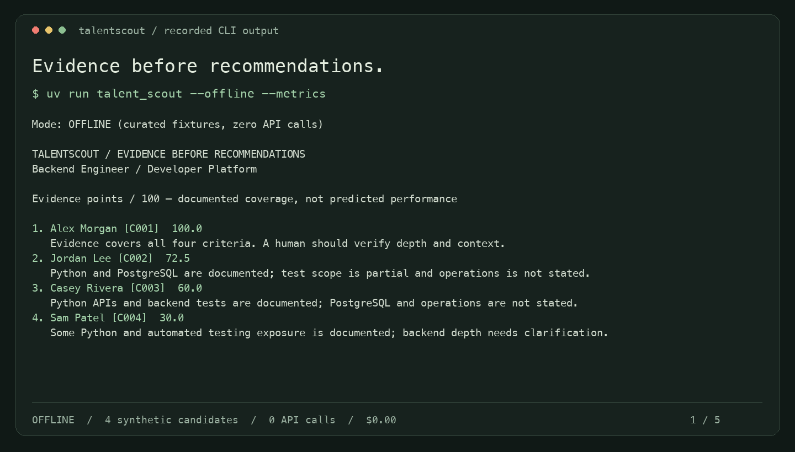

# TalentScout

**Evidence before recommendations. Human judgment before decisions.**

[](https://github.com/sharath559/talentscout/actions/workflows/ci.yml)


A Python portfolio project that turns synthetic resumes into a source-backed review packet.
Claude analyzes each resume, a Judge explains the fixed rubric order, and a fairness reviewer
flags concerns. Every positive assessment needs an exact quote. A person reviews the evidence
and can approve a **simulated** shortlist. There is no hiring, rejection, offer, or ATS action.



## Run in two minutes

Install [uv](https://docs.astral.sh/uv/getting-started/installation/), then run from this directory:

```bash
uv sync --frozen --extra dev
uv run talent_scout --offline --metrics
uv run talent_scout --offline --review
uv run talent_scout --format json
```

No key, account or network is needed after dependencies are installed. The default is offline.
The first command shows four fictional candidates and every supporting quote:

```text
Mode: OFFLINE (curated fixtures, zero API calls)
1. Alex Morgan [C001]   100.0
2. Jordan Lee [C002]    72.5
3. Casey Rivera [C003]  60.0
4. Sam Patel [C004]     30.0
```

These numbers measure documented rubric coverage, **not** predicted job performance or a
probability of suitability. `supported` earns full criterion weight; `partial` earns half;
`not_stated` earns zero and raises a question for a person. Equal scores sort by candidate ID.
The deliberately small reference dataset demonstrates application behavior, not hiring validity.

## What to inspect

| Feature | Implementation |
| --- | --- |
| Bounded Analyzer → Judge → fairness workflow | `src/talentscout/agents.py` |
| Native JSON schemas and strict local validation | `models.py`, `providers.py` |
| Exact source quotes and complete criterion coverage | `validate_analysis()` |
| Count Tokens preflight, output reservation, usage settlement | `providers.py`, `utils.py` |
| Explicit live mode, no automatic retries, sanitized errors | `providers.py`, `main.py` |
| Hash-bound offline replay; no invented scores for unfamiliar input | `data/offline_fixtures.json` |
| Terminal-only approval; every fairness finding blocks it | `main.py` |
| SDK HTTP mock, failure-path tests, optional live eval | `tests/`, `scripts/evaluate.py` |

The workflow has logical fan-out across independent analyses but dispatches sequentially.
It is bounded orchestration, not an open-ended autonomous agent. It does not implement
tournament selection, MCP, prompt caching, or provider-side spend administration.

## Live Claude mode

```bash
cp .env.template .env
# Edit .env locally: add ANTHROPIC_API_KEY and verify MODEL_ID and token prices.
uv run talent_scout --live --hello --metrics
uv run talent_scout --live --budget 0.25 --metrics
```

Live mode sends the job description, sanitized resume text, and prior agent evidence to
Anthropic. Display-name columns are kept out of model prompts; contact-pattern removal is
limited and is not full anonymization. Use the synthetic examples for this portfolio demo.
`.env` is ignored, is loaded only from this directory, and does not override exported variables.

The template selects `claude-haiku-4-5-20251001`, with standard global uncached rates of
$1 input / $5 output per million tokens from the [official pricing page](https://platform.claude.com/docs/en/about-claude/pricing).
These are explicit configuration assumptions, not prices fetched from the Models API.
If you change the model, update **both rates** too. No automatic model switching occurs.

Before generation, the SDK counts the same input configuration, including the transformed
response schema. The app reserves that estimate plus 10% and 1,024 input tokens, and all
`MAX_OUTPUT_TOKENS`. It settles against response usage and keeps uncertain reservations after
timeouts. The budget is **per process run**, not a persistent or provider-enforced billing cap.
See [cost limits and security](docs/SECURITY.md). No paid model evaluation has been recorded.

## Inputs and output

Text jobs have a title, prose description, and explicit rubric lines. Weights must sum to 100:

```text
Backend Engineer
Build and maintain Python backend services with automated tests.
criterion: python | 60 | Explicit experience building Python backend APIs.
criterion: testing | 40 | Explicit experience writing automated backend tests.
```

JSON jobs use `title`, `description`, and `criteria` objects with `id`, `weight`, `description`.
Resume CSV headers must be exactly `candidate_id,name,resume`; quote multiline text normally.
At most 20 candidates, 12 criteria, 12,000 resume characters and 512 KB per file are accepted.

```bash
uv run talent_scout --live --job path/job.json --resumes path/resumes.csv --budget 0.25
mkdir -p artifacts
uv run talent_scout --output artifacts/review.json --audit-log artifacts/audit.jsonl --metrics
```

Custom inputs require live mode; curated offline fixtures reject altered inputs.
JSON reports include names and evidence and should be treated as sensitive.
Audit JSONL contains only event metadata and token counts. Reports never overwrite files.
Normal text/JSON success exits 0; stopped runs exit 2; interruptions exit 130.
Noninteractive runs leave approval pending. `--review` requires a terminal; default is decline.
All findings block approval. Approval records only a local simulation, not a real decision.

## Verify and demo

```bash
uv run ruff check .
uv run ruff format --check .
uv run pytest --cov=talentscout --cov-report=term-missing
uv run python scripts/evaluate.py
bash scripts/demo.sh
```

The real Anthropic SDK is tested against a local HTTP mock. Tests need no credentials.
Offline regression checks fixtures and application contracts; it does not measure Claude's
quality or prove fairness. For a small paid baseline/counterfactual/injection evaluation:

```bash
uv run python scripts/evaluate.py --live --budget 0.50 --output artifacts/live-evaluation.json
```

All evaluation calls share the same budget object. Results may differ from human-authored
expectations; failures are evidence to investigate. CI runs offline checks on Python
3.10, 3.12 and 3.14; all three jobs passed in the
[published validation run](https://github.com/sharath559/talentscout/actions/runs/43057637526).
Optional hooks: install `pre-commit`, then run `pre-commit install`.

## Portfolio guide

- [Architecture and tradeoffs](docs/ARCHITECTURE.md)
- [Threat model and cost controls](docs/SECURITY.md)
- [Limitations and deliberate non-goals](docs/LIMITATIONS.md)
- [Evaluation evidence and live validation plan](docs/EVALUATION.md)
- [Developer competency matrix](docs/CERTIFICATION_SKILLS_MATRIX.md)
- [Project story](docs/PROJECT_STORY.md) and [interview guide](docs/INTERVIEW_GUIDE.md)
- [Build log](docs/BUILD_LOG.md) and [demo walkthrough](docs/DEMO.md)

Built with the official Anthropic Python SDK, Pydantic, python-dotenv and pytest.
MIT licensed. Independent learning project; no Anthropic endorsement or certification claim.
