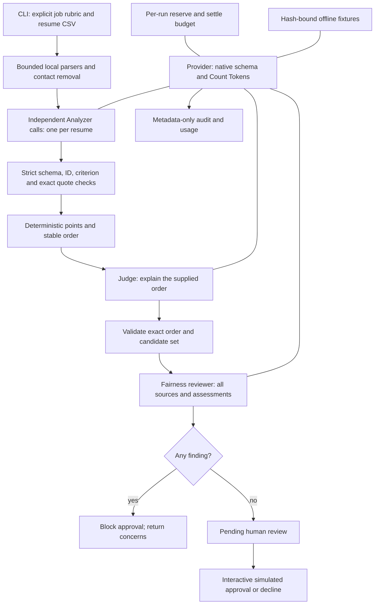

# Architecture

TalentScout separates probabilistic interpretation from deterministic application controls.
The model labels evidence against a person-defined rubric. Python validates provenance,
calculates points, and enforces the approval boundary.

## Data contracts

`Job` has explicit weighted criteria summing to 100. `Candidate` has a local display name,
opaque ID, and sanitized text. Only ID and text enter prompts. `Analysis` covers each
criterion exactly once, with `supported`, `partial` or `not_stated`, exact quotes and a brief
explanation. Unknown keys and invalid types fail validation. Positive labels require quotes.

Python awards weight × 1, 0.5, or 0. Scores are decimals, with no floating-point drift.
`Judgment` must contain the entire expected order exactly. Ties sort by ID. The model cannot
silently add candidates, omit one, or substitute its own ranking. `FairnessReview` has
typed findings, known candidate references, and `human_review_required=true`.

## Provider boundary

`ClaudeProvider` uses the official SDK's Models, Count Tokens and Messages APIs.
`transform_schema()` removes constraints unsupported by native structured outputs;
Pydantic still enforces the original contract after generation. Only completed text responses
are accepted. Usage is accounted before parsing, including refusals and truncation.
The model lookup checks the reported output token limit and structured-output support when
available. There is no code execution, shell tool, URL retrieval or model-selected file tool.

`OfflineProvider` replays curated outputs only if the stage payload's SHA-256 matches the
recorded input. Names may change because they are absent from prompts. The hash protects
demo consistency; an attacker able to modify both fixture and code is outside that boundary.

## Orchestration choices

- Sequential dispatch makes reservations and failure ordering easy to inspect. Independent
  Analyzer tasks demonstrate logical fan-out, not concurrent execution.
- Judge and fairness roles use separate calls, not separate models or independent authorities.
  Shared-model mistakes can be correlated.
- There is no tournament: deterministic rubric order makes one unnecessary.
- No caching is enabled. It would add cache-write accounting and privacy considerations.
- A failure halts the pipeline. Partial results are not silently substituted for missing stages.
- Reports are explicit local exports. There is no database, ATS, deployment or real hiring action.

## API references

Implementation reviewed against the official [SDK](https://github.com/anthropics/anthropic-sdk-python),
[Count Tokens API](https://platform.claude.com/docs/en/api/messages/count_tokens),
[Models API](https://platform.claude.com/docs/en/api/models/retrieve), and
[structured outputs guide](https://platform.claude.com/docs/en/build-with-claude/structured-outputs).
